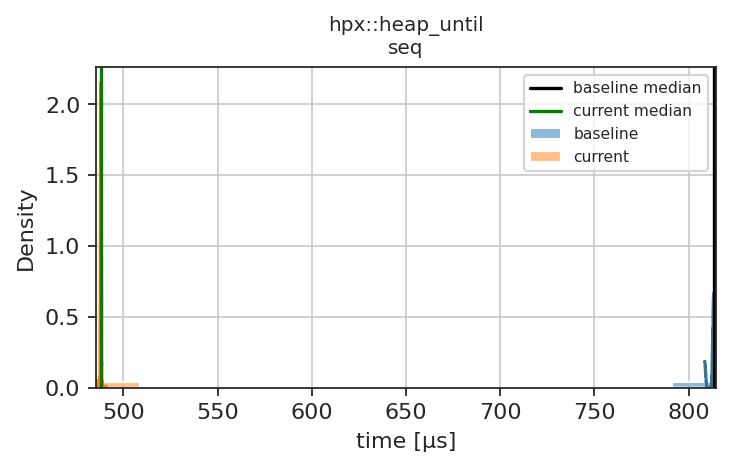
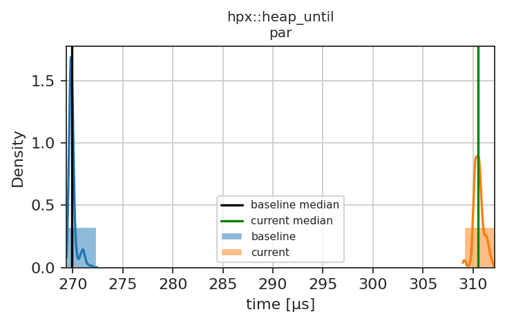
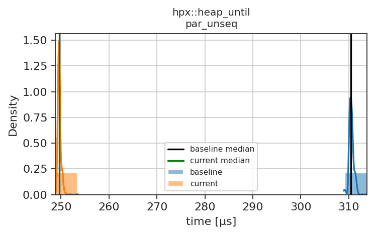
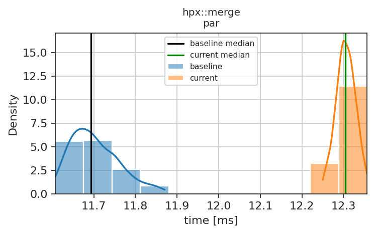
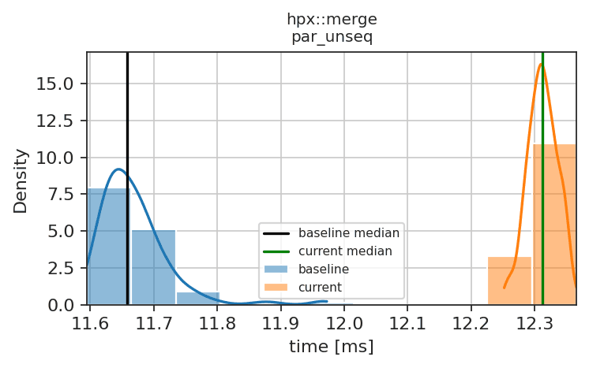
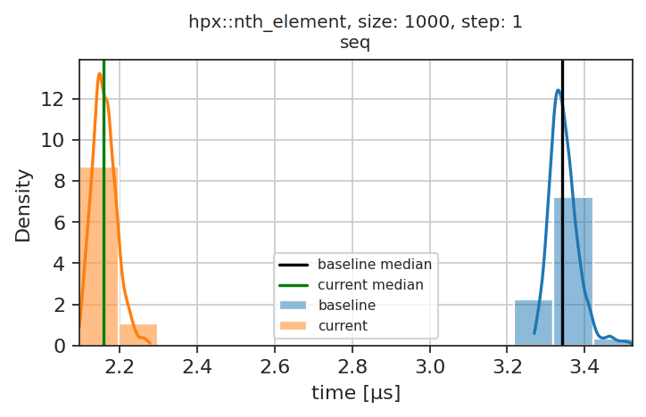
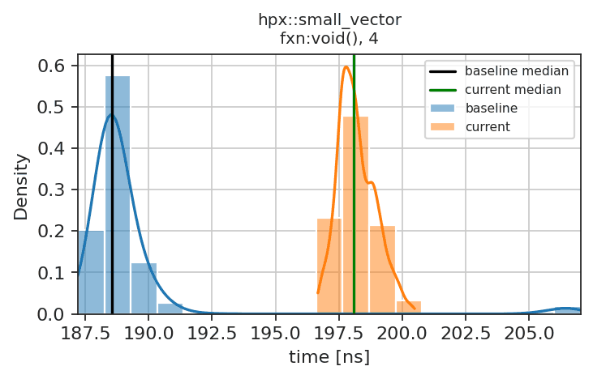
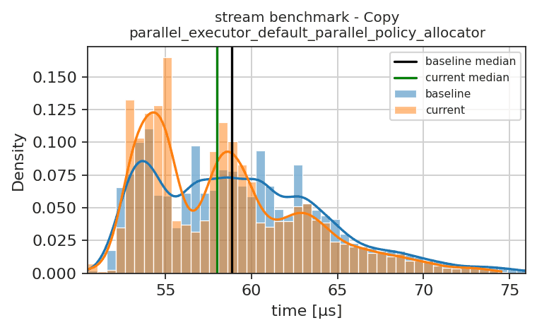

# Performance test report

Pull request [#7863](https://github.com/TheHPXProject/hpx/pull/7863), [all reports of the pull request](../README.md)

Commit <a href="https://github.com/TheHPXProject/hpx/commit/bea790fa3cb979d47dc78620b59a98c1e2cbef43">bea790fa3cb979d47dc78620b59a98c1e2cbef43</a>, Jenkins build <a href="https://rostam.cct.lsu.edu/jenkins/job/HPX-performance-tests/6168/">6168</a>

<table><tr><th>Property</th><th>Reference</th><th>Current</th></tr><tr><td>Run date</td><td>2026-10-23T10:43:38.096470-05:00</td><td>2026-10-25T10:19:10.982973-05:00</td></tr><tr><td>Host</td><td>medusa11.rostam.cct.lsu.edu</td><td>medusa11.rostam.cct.lsu.edu</td></tr><tr><td>Compiler</td><td>/opt/apps/llvm/18.1.8/bin/clang++</td><td>/opt/apps/llvm/18.1.8/bin/clang++</td></tr></table>

<table><tr><th>Test name</th><th>Executor</th><th>Percentage Diff.</th><th>Classification</th></tr><tr><th scope="row" colspan="4">benchmark_is_heap_until</th></tr><tr><th>hpx::heap_until</th><td>seq</td><td>39.99 %</td><td>+++</td></tr><tr><td colspan="4">

Plot

</td></tr><tr><th>hpx::heap_until</th><td>par</td><td>-15.07 %</td><td>---</td></tr><tr><td colspan="4">

Plot

</td></tr><tr><th>hpx::heap_until</th><td>par_unseq</td><td>19.61 %</td><td>+++</td></tr><tr><td colspan="4">

Plot

</td></tr><tr><th scope="row" colspan="4">benchmark_merge</th></tr><tr><th>hpx::merge</th><td>par</td><td>-5.22 %</td><td>--</td></tr><tr><td colspan="4">

Plot

</td></tr><tr><th>hpx::merge</th><td>par_unseq</td><td>-5.62 %</td><td>--</td></tr><tr><td colspan="4">

Plot

</td></tr><tr><th scope="row" colspan="4">benchmark_nth_element</th></tr><tr><th>hpx::nth_element, size: 1000, step: 1</th><td>seq</td><td>35.41 %</td><td>+++</td></tr><tr><td colspan="4">

Plot

</td></tr><tr><th scope="row" colspan="4">small_vector_benchmark</th></tr><tr><th>hpx::small_vector</th><td>fxn:void(), 4</td><td>-5.06 %</td><td>--</td></tr><tr><td colspan="4">

Plot

</td></tr><tr><th scope="row" colspan="4">stream_report</th></tr><tr><th>stream benchmark - Copy</th><td>parallel_executor_default_parallel_policy_allocator</td><td>1.42 %</td><td>++</td></tr><tr><td colspan="4">

Plot

</td></tr></table>

<h3>Explanation of Symbols</h3>
The benchmarks ran on medusa11, the results are compared with the references of that node.

Percentage Diff. is the change of the median time relative to the reference, positive values mean faster.
<table><tr><th>Symbol</th><th>Meaning</th></tr><tr><td>=</td><td>No performance change (confidence interval within &plusmn;1%)</td></tr><tr><td>(=)</td><td>Probably no performance change (confidence interval within &plusmn;2%)</td></tr><tr><td>(+)/(-)</td><td>Very small performance improvement/degradation (&le;1%)</td></tr><tr><td>+/-</td><td>Small performance improvement/degradation (&le;5%)</td></tr><tr><td>++/--</td><td>Large performance improvement/degradation (&le;10%)</td></tr><tr><td>+++/---</td><td>Very large performance improvement/degradation (&gt;10%)</td></tr><tr><td>?</td><td>Probably no change, but quite large uncertainty (confidence interval within &plusmn;5%)</td></tr><tr><td>??</td><td>Unclear result, very large uncertainty (&plusmn;10%)</td></tr><tr><td>???</td><td>Something unexpected</td></tr><tr><td>no reference</td><td>No reference results for this node yet, the plot shows only the current results</td></tr></table>
