# Performance test report

Pull request [#7888](https://github.com/TheHPXProject/hpx/pull/7888), [all reports of the pull request](../README.md)

Build 1: the lane's steps run outside Jenkins, without the CDash submits

The results of this run (the measurements of all benchmarks, the comparison and the logs of the run) are uploaded as <a href="results-7888-1.tar.gz">results-7888-1.tar.gz</a>.

medusa08 has no references for some of the benchmarks (new ones, or ones whose measurements changed). New references of all its benchmarks, measured by this run, are uploaded as <a href="references/medusa08.tar.gz">medusa08.tar.gz</a>, copy it to tools/perftests_ci/perftest/references to use them.

<table><tr><th>Property</th><th>Reference</th><th>Current</th></tr><tr><td>Run date</td><td>2026-10-21T07:02:15.929664-05:00</td><td>2026-10-27T06:09:41.350618-05:00</td></tr><tr><td>Host</td><td>medusa08.rostam.cct.lsu.edu</td><td>medusa08.rostam.cct.lsu.edu</td></tr><tr><td>Compiler</td><td>/opt/apps/llvm/18.1.8/bin/clang++</td><td>/opt/apps/llvm/18.1.8/bin/clang++</td></tr></table>

<table><tr><th>Test name</th><th>Executor</th><th>Percentage Diff.</th><th>Classification</th></tr><tr><th scope="row" colspan="4">benchmark_is_heap</th></tr><tr><th>hpx::is_heap</th><td>par</td><td>-21.43 %</td><td>---</td></tr><tr><td colspan="4">

Plot
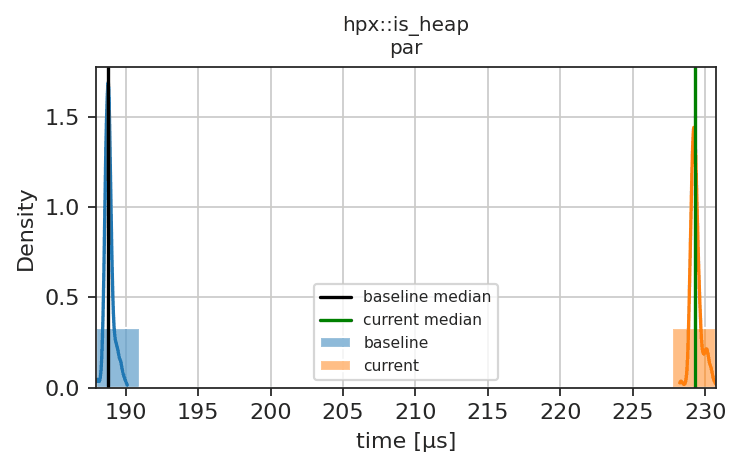
</td></tr><tr><th>hpx::is_heap</th><td>par_unseq</td><td>-21.41 %</td><td>---</td></tr><tr><td colspan="4">

Plot
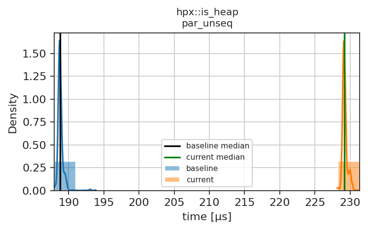
</td></tr><tr><th scope="row" colspan="4">benchmark_is_heap_until</th></tr><tr><th>hpx::heap_until</th><td>seq</td><td>40.00 %</td><td>+++</td></tr><tr><td colspan="4">

Plot
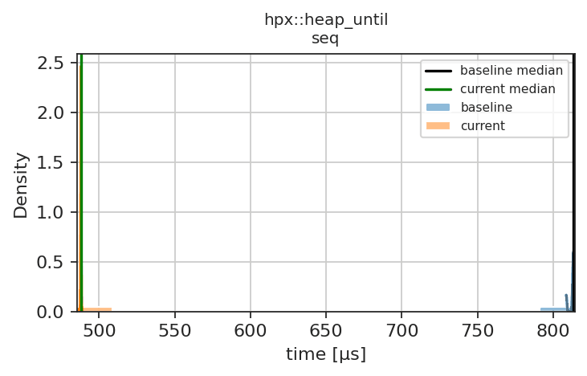
</td></tr><tr><th>hpx::heap_until</th><td>par_unseq</td><td>13.07 %</td><td>+++</td></tr><tr><td colspan="4">

Plot
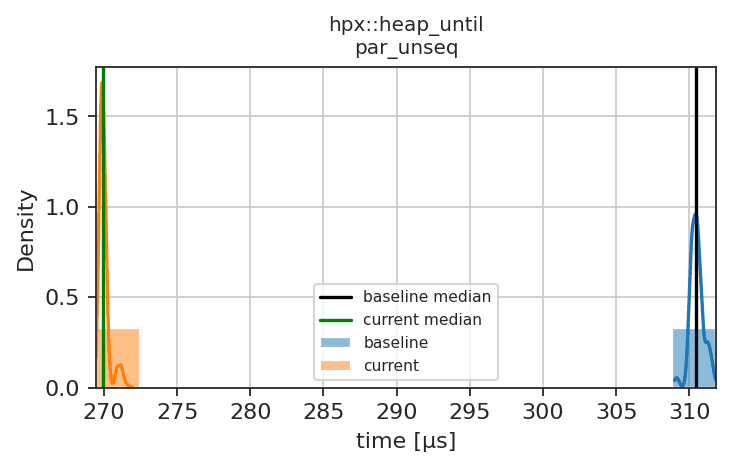
</td></tr><tr><th scope="row" colspan="4">benchmark_merge</th></tr><tr><th>hpx::merge</th><td>par</td><td>-5.26 %</td><td>--</td></tr><tr><td colspan="4">

Plot
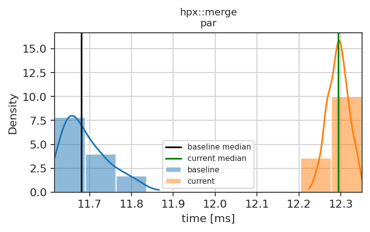
</td></tr><tr><th>hpx::merge</th><td>par_unseq</td><td>-5.59 %</td><td>--</td></tr><tr><td colspan="4">

Plot
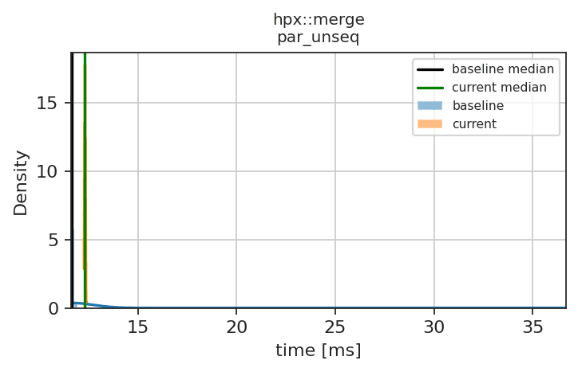
</td></tr><tr><th scope="row" colspan="4">benchmark_nth_element</th></tr><tr><th>hpx::nth_element, size: 1000, step: 1</th><td>seq</td><td>37.61 %</td><td>+++</td></tr><tr><td colspan="4">

Plot
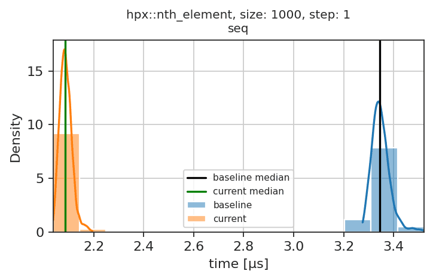
</td></tr><tr><th scope="row" colspan="4">benchmark_remove</th></tr><tr><th>hpx::remove</th><td>par</td><td>-14.33 %</td><td>---</td></tr><tr><td colspan="4">

Plot
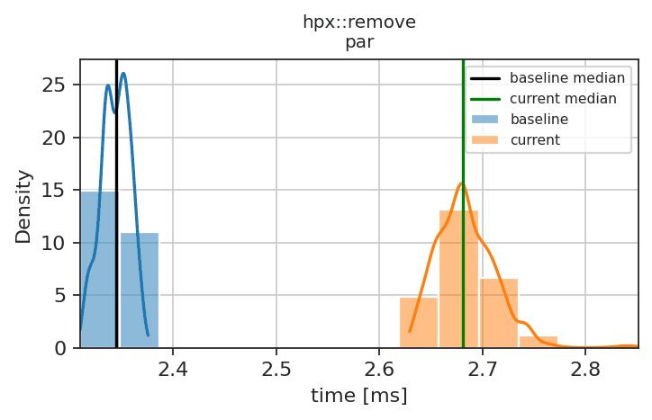
</td></tr><tr><th scope="row" colspan="4">benchmark_remove_if</th></tr><tr><th>hpx::remove_if</th><td>seq</td><td>8.25 %</td><td>++</td></tr><tr><td colspan="4">

Plot
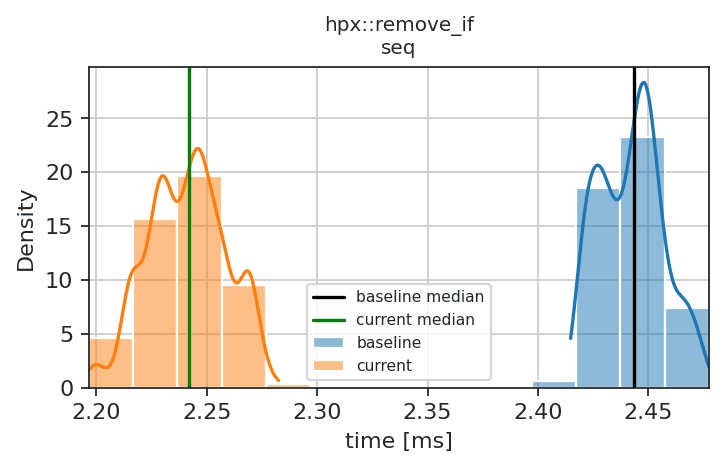
</td></tr><tr><th>hpx::remove_if</th><td>par_unseq</td><td>12.24 %</td><td>+++</td></tr><tr><td colspan="4">

Plot
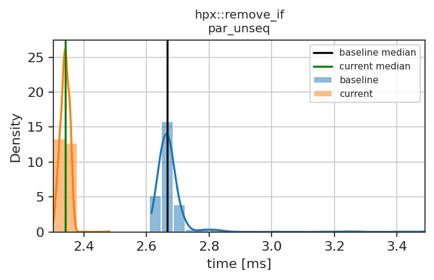
</td></tr><tr><th scope="row" colspan="4">small_vector_benchmark</th></tr><tr><th>hpx::small_vector</th><td>int, 2</td><td>-8.06 %</td><td>--</td></tr><tr><td colspan="4">

Plot
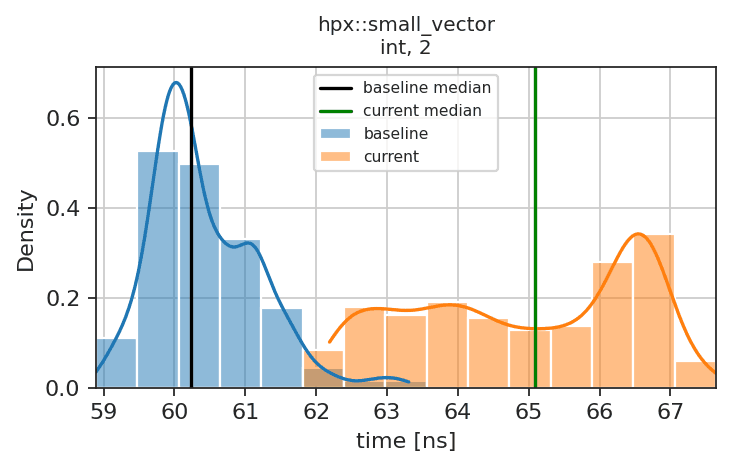
</td></tr><tr><th>hpx::small_vector</th><td>int, 4</td><td>7.02 %</td><td>++</td></tr><tr><td colspan="4">

Plot
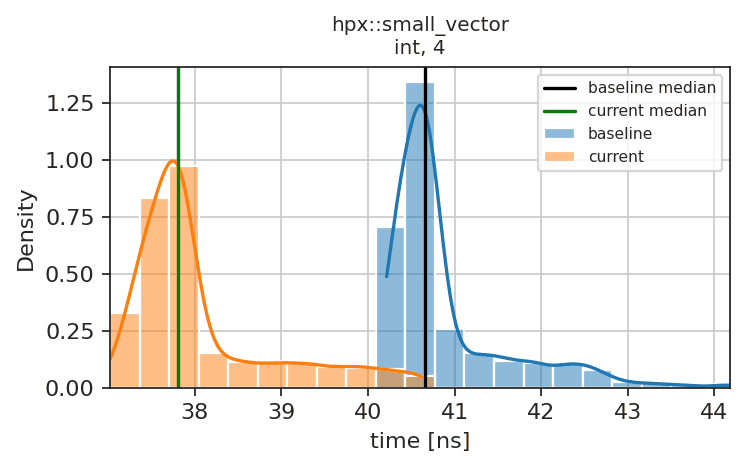
</td></tr><tr><th>hpx::small_vector</th><td>int, 8</td><td>11.88 %</td><td>+++</td></tr><tr><td colspan="4">

Plot
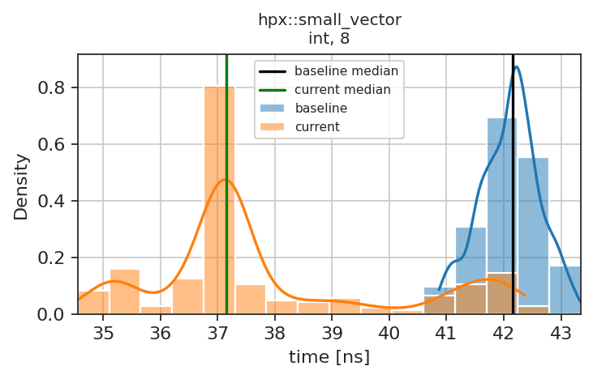
</td></tr><tr><th>hpx::small_vector</th><td>int, 16</td><td>35.71 %</td><td>+++</td></tr><tr><td colspan="4">

Plot
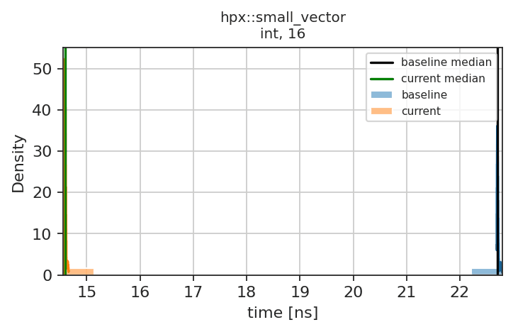
</td></tr><tr><th scope="row" colspan="4">scheduler_latency_report</th></tr><tr><th>scheduler latency - sparse</th><td>post</td><td>n/a</td><td>no reference</td></tr><tr><td colspan="4">

Plot
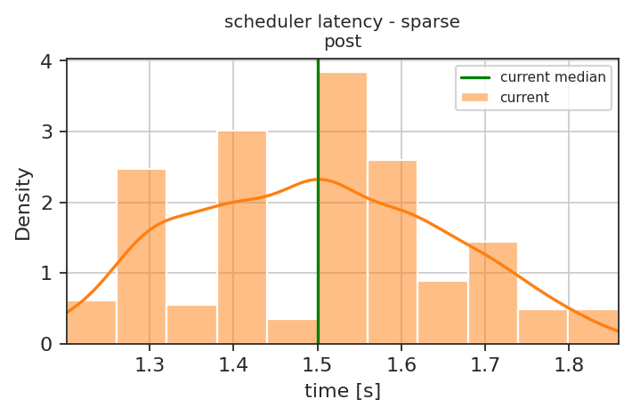
</td></tr><tr><th>scheduler latency - burst</th><td>post</td><td>n/a</td><td>no reference</td></tr><tr><td colspan="4">

Plot
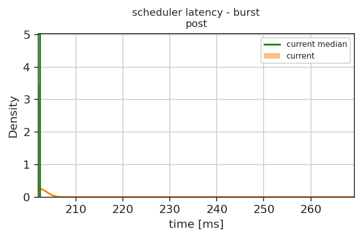
</td></tr><tr><th>scheduler latency - batch</th><td>parallel_executor</td><td>n/a</td><td>no reference</td></tr><tr><td colspan="4">

Plot
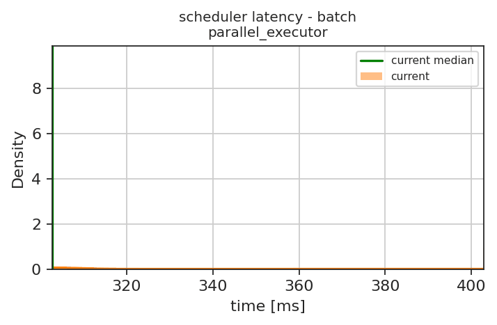
</td></tr><tr><th>scheduler latency - loop</th><td>par</td><td>n/a</td><td>no reference</td></tr><tr><td colspan="4">

Plot
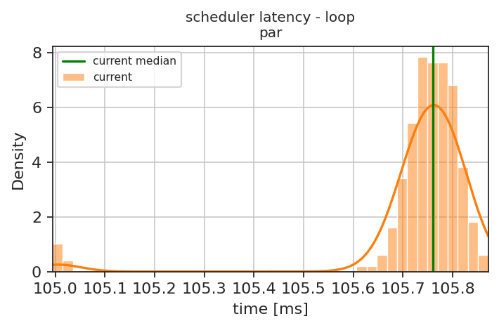
</td></tr><tr><th scope="row" colspan="4">scheduler_throughput_report</th></tr><tr><th>scheduler throughput - spawn</th><td>parallel_executor</td><td>n/a</td><td>no reference</td></tr><tr><td colspan="4">

Plot
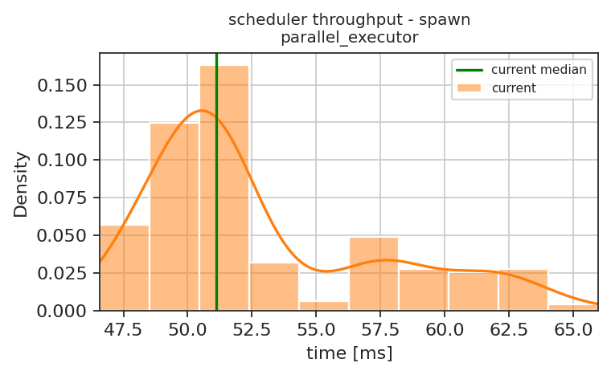
</td></tr><tr><th>scheduler throughput - spawnself</th><td>parallel_executor</td><td>n/a</td><td>no reference</td></tr><tr><td colspan="4">

Plot
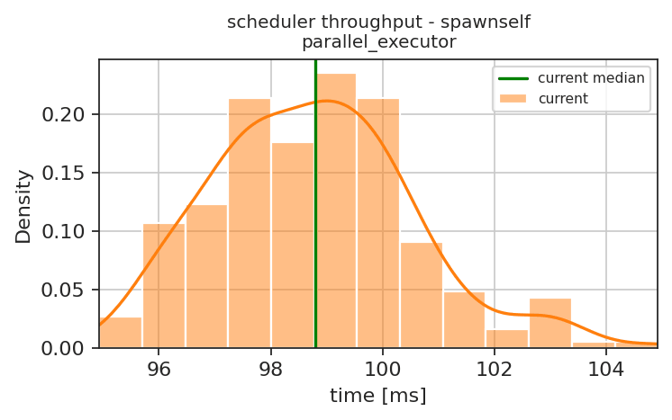
</td></tr><tr><th>scheduler throughput - steal</th><td>parallel_executor</td><td>n/a</td><td>no reference</td></tr><tr><td colspan="4">

Plot
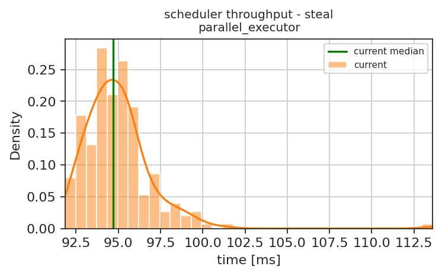
</td></tr></table>

<h3>Explanation of Symbols</h3>
Percentage Diff. is the change of the median time relative to the reference, positive values mean faster.
<table><tr><th>Symbol</th><th>Meaning</th></tr><tr><td>=</td><td>No performance change (confidence interval within &plusmn;1%)</td></tr><tr><td>(=)</td><td>Probably no performance change (confidence interval within &plusmn;2%)</td></tr><tr><td>(+)/(-)</td><td>Very small performance improvement/degradation (&le;1%)</td></tr><tr><td>+/-</td><td>Small performance improvement/degradation (&le;5%)</td></tr><tr><td>++/--</td><td>Large performance improvement/degradation (&le;10%)</td></tr><tr><td>+++/---</td><td>Very large performance improvement/degradation (&gt;10%)</td></tr><tr><td>?</td><td>Probably no change, but quite large uncertainty (confidence interval within &plusmn;5%)</td></tr><tr><td>??</td><td>Unclear result, very large uncertainty (&plusmn;10%)</td></tr><tr><td>???</td><td>Something unexpected</td></tr><tr><td>no reference</td><td>No reference results for this node yet, the plot shows only the current results</td></tr></table>
